<p align="center">
  
</p>

<p align="center">
  
  
</p>

Capsules of code and notes launched from the home vault toward the work machine.
Each pod is one directory, `YYYY-MM-DD-<subject>/`, holding a `README.md` (context,
decisions, how to apply) and the code as **real files** ready to copy.

> **Public on purpose.** No secret, no credential, no employer code or internal name
> ever rides in a pod.

## 🛰️ How it flies

```
  home vault ──── /drop-pod ────▶  Arylmera/Drop-Pod  ────▶ git pull ────▶ work machine
  (discussion)   writes the pod      (public repo)          pod-receive     (apply)
```

## 📡 Receiving side

Once:

```bash
git clone https://github.com/Arylmera/Drop-Pod.git
```

Each time a pod lands:

```bash
git pull
git log -1 --stat
```

Open the directory shown, read its `README.md`, copy the files.

## 🤖 Agent on the receiving side

The receiving procedure lives in [`AGENTS.md`](AGENTS.md), the file most coding agents read
on their own (OpenCode, IBM Bob, Codex, Copilot). Claude Code gets the same procedure through
[`.claude/skills/pod-receive/SKILL.md`](.claude/skills/pod-receive/SKILL.md), which only
points at it. Working from the target project instead of this clone? Paste the relevant part
of `AGENTS.md` into that project's agent file, or tell the agent to read it from the clone path.

## 📦 Pod contract

| Section | Holds |
|---|---|
| `## Context` | Two lines: the problem and the target project. `follows <pod>` when it continues one. |
| `## Decisions` | Choices already made. Not reopened on the receiving side. |
| `## Apply` | Ordered steps; a copy step names the file and its destination. |
| `## Files` | One bullet per shipped file and its role. |

Code is shipped as real files with their final names; the README never carries code.
A pod is never edited after landing.

## 🪂 Pods

<!-- pods:index -->
- [2026-10-13-devoxx-talk-1-ai-reality-check](2026-10-13-devoxx-talk-1-ai-reality-check/) — Devoxx 2026 series, talk 1 of 5: AI, the reality check (HTML deck + talking points)
- [2026-10-13-devoxx-talk-2-harness](2026-10-13-devoxx-talk-2-harness/) — Devoxx 2026 series, talk 2 of 5: The harness around the agent (HTML deck + talking points)
- [2026-10-13-devoxx-talk-3-context](2026-10-13-devoxx-talk-3-context/) — Devoxx 2026 series, talk 3 of 5: Context is the product (HTML deck + talking points)
- [2026-10-13-devoxx-talk-4-trust-at-scale](2026-10-13-devoxx-talk-4-trust-at-scale/) — Devoxx 2026 series, talk 4 of 5: Trust at scale (HTML deck + talking points)
- [2026-10-13-devoxx-talk-5-bonus-java-craft](2026-10-13-devoxx-talk-5-bonus-java-craft/) — Devoxx 2026 series, bonus talk (5 of 5): Bonus: Java craft (HTML deck + talking points)
- [2026-10-16-opencode-probe](2026-10-16-opencode-probe/) — read-only probe of OpenCode session state, for planning OpenCode support in Administratum
<!-- /pods:index -->
